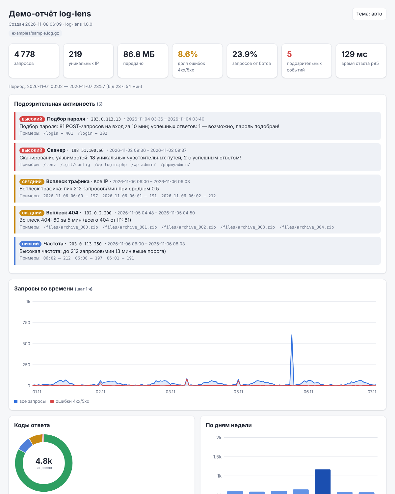
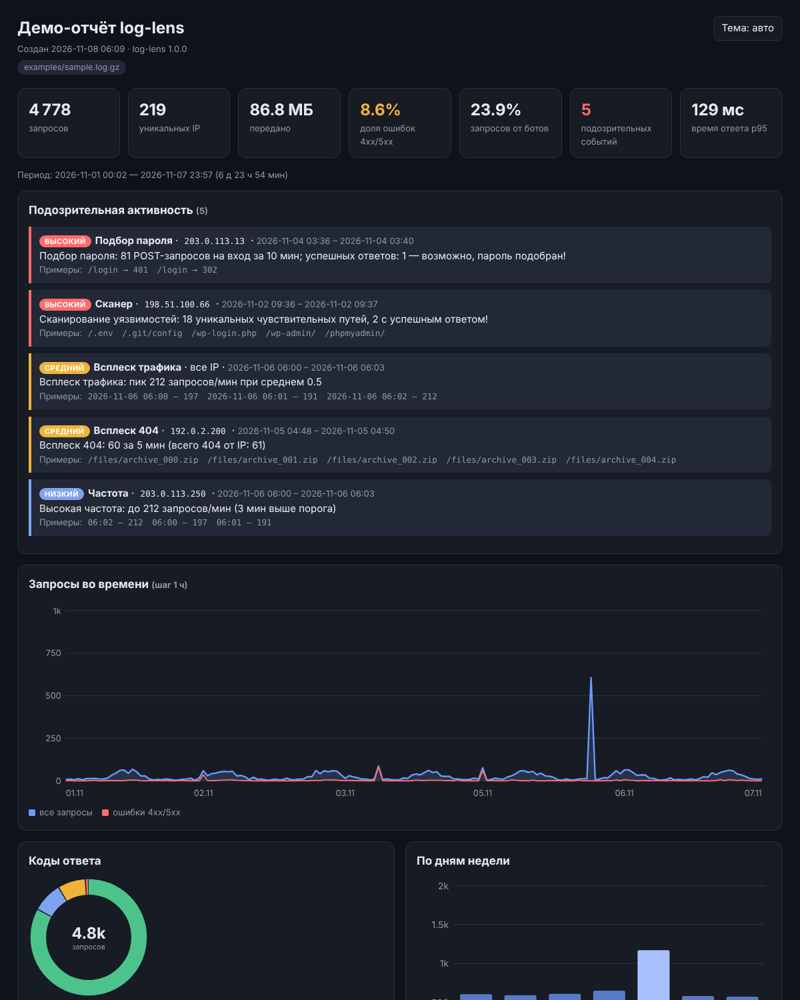

# log-lens

**Анализатор access-логов nginx и Apache.** Утилита командной строки на чистом Python читает логи, в том числе сжатые `.gz`, и выдаёт статистику по трафику, ищет подозрительную активность (сканеры уязвимостей, подбор паролей, перебор URL, флуд) и строит **автономный HTML-отчёт** с графиками в одном файле. Внешних зависимостей нет: хватает Python 3.9+.



<details><summary>Тёмная тема</summary>


</details>

## Возможности

- **Форматы логов:** `combined` (стандарт nginx/Apache), `common`, `timed` (combined + `$request_time`) и **любой пользовательский формат** в синтаксисе `log_format` nginx. Формат определяется автоматически.
- **Источники:** несколько файлов сразу, `.gz` (распознаётся по содержимому, так что `access.log.2` тоже подойдёт), стандартный ввод `-`.
- **Статистика:** запросы, уникальные IP, трафик, доля ошибок и ботов, коды ответа, методы, топы путей, IP, User-Agent и рефереров, пути с ошибками 4xx/5xx, нагрузка по часам и дням недели, временная шкала, время ответа (среднее, p50/p95/p99) и самые медленные страницы.
- **Детекторы подозрительной активности:**
  - `scanner`: IP перебирает чувствительные пути (`/.env`, `/.git/config`, `/wp-login.php`, `/phpmyadmin` …). Если сервер отдал на них успешный ответ, уровень повышается;
  - `bruteforce`: серия POST-запросов к страницам входа за 10 минут, с отметкой «возможно, пароль подобран», если среди них был успешный ответ;
  - `404-burst`: много ответов 404 за 5 минут (перебор файлов);
  - `rate`: слишком много запросов в минуту с одного IP;
  - `spike`: общий всплеск трафика (минута, которая выбивается из среднего больше чем на 4σ).
- **Фильтры:** по дате (`--since`, `--until`, `--last 24h`), статусу (`404`, `4xx`, `500-599`, `!2xx`), пути (регулярное выражение), IP и подсетям (IPv4/IPv6), методу; можно исключить ботов или оставить только их.
- **Вывод:** цветной текст в терминал, JSON для скриптов, HTML-отчёт (светлая и тёмная тема, сортировка и фильтр таблиц, подсказки на графиках, адаптивная вёрстка).
- **Для cron и CI:** с флагом `--fail-on high` утилита завершается с кодом 3, если найдено событие такого уровня.
- **Генератор тестовых логов** с реалистичным суточным профилем и сценариями атак. IP-адреса берутся из диапазонов для документации (RFC 5737).

## Пример вывода

```text
$ log-lens analyze examples/sample.log.gz --top 5

Сводка
────────────────────────────────────────────────────────────────
  Запросов:        4 778
  Уникальных IP:   219
  Передано:        86.8 МБ
  Период:          2026-11-01 00:02 — 2026-11-07 23:57 (6 д 23 ч 54 мин)
  Доля ошибок:     8.6% (4xx: 368, 5xx: 43)
  Доля ботов:      23.9%
  Время ответа:    сред. 51 мс, p50 37 мс, p95 129 мс, макс. 4539 мс

Подозрительная активность
────────────────────────────────────────────────────────────────
  [ВЫСОКИЙ] Подбор пароля · 203.0.113.13 · 2026-11-04 03:36–03:40
      Подбор пароля: 81 POST-запросов на вход за 10 мин; успешных ответов: 1 — возможно, пароль подобран!
  [ВЫСОКИЙ] Сканер · 198.51.100.66 · 2026-11-02 09:36–09:37
      Сканирование уязвимостей: 18 уникальных чувствительных путей, 2 с успешным ответом!
  [СРЕДНИЙ] Всплеск 404 · 192.0.2.200 · 2026-11-05 04:48–04:50
      Всплеск 404: 60 за 5 мин (всего 404 от IP: 61)
  ...
```

Полный текстовый отчёт лежит в [`examples/report.txt`](examples/report.txt), HTML-отчёт — в [`examples/report.html`](examples/report.html).

## Установка

```bash
git clone https://github.com/mrsolo743-dot/log-lens.git
cd log-lens
pip install .            # появится команда log-lens
# или без установки:  python -m log_lens ...
```

Python 3.9 или новее. Сторонних библиотек утилите не нужно.

## Запуск

```bash
# сводка в терминале
log-lens analyze /var/log/nginx/access.log

# HTML-отчёт по всем логам, включая архивные .gz
log-lens analyze /var/log/nginx/access.log* -o report.html

# только ошибки 5xx за конкретные дни
log-lens analyze access.log --status 5xx --since 2026-11-01 --until 2026-11-03

# последние сутки без ботов, топ-20, в JSON
log-lens analyze access.log --last 24h --exclude-bots --top 20 --output json > stats.json

# запросы к API из одной подсети
log-lens analyze access.log --path '^/api/' --ip 203.0.113.0/24

# свой формат лога (как в log_format nginx)
log-lens analyze app.log --format '$remote_addr $host [$time_local] "$request" $status $body_bytes_sent $request_time'

# из стандартного ввода
zcat access.log.*.gz | log-lens analyze -

# проверка из cron: код выхода 3, если есть события уровня «высокий»
log-lens analyze access.log --last 1h --fail-on high -o /tmp/hourly.txt || echo "Внимание!"

# сгенерировать демо-лог и посмотреть отчёт
log-lens generate -n 20000 --days 14 -o demo.log
log-lens analyze demo.log -o demo.html
```

Все параметры выводит `log-lens analyze --help`.

| Параметр | Что делает |
|---|---|
| `-f, --format` | `auto` (по умолчанию), `combined`, `common`, `timed` или строка `log_format` |
| `-o, --out` | файл отчёта, формат по расширению: `.html`, `.json`, `.txt` |
| `--output` | `text`, `json` или `html` (если нужно задать формат явно) |
| `-n, --top` | сколько строк в топах (10) |
| `--since`, `--until`, `--last` | временной диапазон; `--last` отсчитывается от последней записи в логе |
| `--status`, `--path`, `--ip`, `--method` | фильтры |
| `--exclude-bots`, `--only-bots` | фильтр по User-Agent |
| `--keep-query` | не отбрасывать `?query` при группировке путей |
| `--burst-404`, `--brute`, `--rate` | пороги детекторов |
| `--no-detect` | не запускать детекторы |
| `--fail-on low/medium/high` | код выхода 3 при найденных событиях |

## Тесты

```bash
pip install pytest            # обязательно
pip install playwright        # необязательно: проверка HTML в браузере
python -m playwright install chromium

python -m pytest -q
```

61 тест: парсер, фильтры, агрегация, детекторы, генератор, текстовый, JSON- и HTML-отчёты, CLI. Если Playwright установлен, HTML-отчёт дополнительно открывается в Chromium: проверяются сортировка и фильтр таблиц, переключение темы, отсутствие ошибок в консоли и горизонтальной прокрутки на мобильной ширине. Без Playwright эти тесты пропускаются.

## Структура проекта

```text
log-lens/
├── log_lens/
│   ├── __init__.py       # версия
│   ├── __main__.py       # запуск через python -m log_lens
│   ├── cli.py            # командная строка: analyze, generate
│   ├── parser.py         # разбор строк, форматы, log_format nginx, чтение .gz/stdin
│   ├── filters.py        # фильтры по времени, статусу, пути, IP, методу, ботам
│   ├── analyzer.py       # агрегация статистики за один проход
│   ├── detectors.py      # поиск подозрительной активности
│   ├── report.py         # модель отчёта, текстовый и JSON-вывод
│   ├── html_report.py    # автономный HTML-отчёт (CSS и JS встроены)
│   ├── svg.py            # SVG-графики без библиотек
│   └── generator.py      # генератор тестовых логов
├── tests/                # pytest (+ браузерные тесты на Playwright)
├── examples/             # демо-лог и готовые отчёты
├── docs/                 # скриншоты для README
├── pyproject.toml
├── LICENSE
└── README.md
```

Как устроен код, расписано в [ОБЪЯСНЕНИЕ.md](ОБЪЯСНЕНИЕ.md).

## Лицензия

[MIT](LICENSE)
